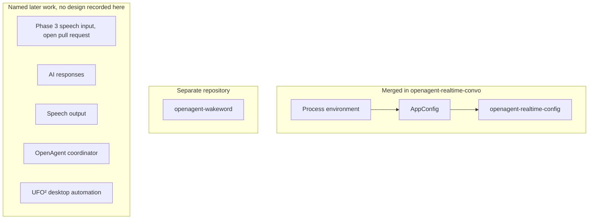

# Architecture

This document describes the merged package at commit `47ecc5a`. Phase 3 and
later conversation behavior are outside this architecture. Their status is in
[Project status](PROJECT_STATUS.md).

## Component boundaries



`openagent-wakeword` is a separate repository for wake-word detection. This
repository does not import it, depend on it, or define a handoff event,
payload, process model, or microphone owner. UFO² is a future assistant
integration with no type, module, or protocol in this tree. The intended
boundaries and explicitly planned connections are in
[Integration map](INTEGRATION_MAP.md).

The public GitHub description names Pipecat, Deepgram Flux, and speech
synthesis. Those names are product direction. They are not modules in the
merged package.

## Package layout

The installable distribution is `openagent-realtime-convo` `0.1.0`. The import
package is `openagent_realtime_convo`, discovered from `src` by setuptools.
`requires-python` is `>=3.12`. Runtime `dependencies` is empty. The author
field is `OpenAgent`. License metadata is the SPDX string `MIT`.

| Module | Responsibility |
| --- | --- |
| `config.py` | Validate environment-backed settings |
| `logging.py` | Emit a fixed set of JSON log fields |
| `__main__.py` | Configuration command |
| `__init__.py` | Export `AppConfig`, `AudioSettings`, `ProviderSettings`, and `ConfigurationError` |

The only console script on this branch is:

```text
openagent-realtime-config = openagent_realtime_convo.__main__:main
```

## Configuration flow

`AppConfig.from_environment` reads a mapping. When the caller omits that
mapping, it reads `os.environ`. There is no `.env` loader and no provider SDK.

```text
OPENAGENT_PROVIDER
OPENAGENT_PROVIDER_API_KEY
OPENAGENT_AUDIO_SAMPLE_RATE_HZ
OPENAGENT_AUDIO_CHANNELS
OPENAGENT_AUDIO_CHUNK_SIZE
        |
        v
AppConfig.from_environment()
        |
        +-- AudioSettings
        +-- ProviderSettings
        |
        v
openagent-realtime-config
        |
        +-- success: JSON event configuration_loaded, exit 0
        +-- ConfigurationError: JSON event configuration_invalid,
            plain-text error on stderr, exit 2
```

### Audio settings

`AudioSettings` is a frozen slotted dataclass. Defaults are `16000` Hz, `1`
channel, and `320` samples per chunk. Each field must be an `int` greater than
zero. `bool` is rejected because it is a subclass of `int`.

The class stores capture parameters only. It does not open a device, choose a
host API, or document a frame duration. At the default rate, `320` samples span
20 ms. That duration is arithmetic from the defaults. The source does not
record it as a design rule.

Environment parsing uses the same defaults when a variable is absent. A present
value must parse as a positive integer. The environment path does not accept
boolean text.

### Provider settings

`ProviderSettings` stores a generic `name` and an `api_key`. Both must contain
non-whitespace characters. The stored strings are the raw environment values.
The key uses `field(repr=False)`, so `repr` omits it.

This type identifies a future provider. It does not construct a client, select
Deepgram, or choose a speech-synthesis vendor. The merged tree has one
credential variable, `OPENAGENT_PROVIDER_API_KEY`.

`ConfigurationError` subclasses `ValueError`.

## Logging

`configure_logging` attaches one `StreamHandler` to the logger
`openagent_realtime_convo` when the logger has no handlers. Propagation is
disabled. The handler uses `JsonFormatter`, which writes compact JSON with
`sort_keys=True`.

The formatter emits only:

| Field | Source |
| --- | --- |
| `event` | `record.event` when present, otherwise the log message |
| `level` | `record.levelname` |
| `logger` | `record.name` |
| `provider` | `record.provider`, included only when it is not `None` |

`log_configuration_loaded` records `configuration_loaded` and the provider
name. A failed load records `configuration_invalid` and does not attach the
provider or the exception text. The command also prints
`Configuration error: ...` to stderr. Those configuration messages name the
invalid field or variable. They do not include the API key.

`StreamHandler()` writes to stderr.

A successful run for provider `example` produces this record:

```json
{"event": "configuration_loaded", "level": "INFO", "logger": "openagent_realtime_convo", "provider": "example"}
```

## What this architecture includes

The merged behavior is configuration validation, safe structured logging, and
the `openagent-realtime-config` command. Quality gates around that package are
documented in [Testing](TESTING.md) and [Security](SECURITY.md).

## Related documents

- [README](../README.md)
- [Project status](PROJECT_STATUS.md)
- [Setup](SETUP.md)
- [Security](SECURITY.md)
- [Decisions](DECISIONS.md)
- [Integration map](INTEGRATION_MAP.md)
- [Roadmap](ROADMAP.md)
- [Agent guide](../AGENTS.md)
